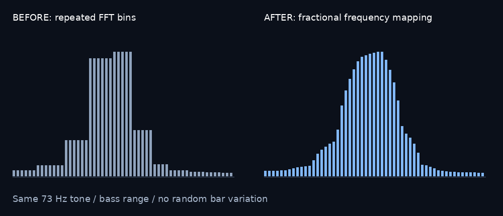

# DeRo Cinematic Visualizer v0.1.32 — Artist and Song Lookup

A standalone, reusable Python 3.12 music visualizer. It renders cinematic floating dust (irregular flecks and small streaks) and a bottom-center **horizontally mirrored** fine-band spectrum. Defaults: 75% independently drifting particles, 25% mildly music-reactive. Output MP4 includes original music.

## Setup (Windows)
1. Ensure **Python 3.12** and **FFmpeg** are installed. Put `C:\FFmpeg\bin` on PATH or otherwise make `ffmpeg` available.
2. Keep all files together and double-click **Launch_DeRo_Visualizer.bat**. It checks and installs `numpy` and `Pillow` if needed.
3. Choose a music file (MP3, WAV, FLAC, M4A, etc). You may choose a JPG/PNG background, or leave blank for the dark navy gradient.
4. Adjust title, number of dust particles, reactive %, and sensitivity. Click **Refresh Preview** after changing settings, and **Export MP4** when ready.
5. Defaults: 1920×1080 / 60 FPS. 30 FPS and smaller resolutions are selectable.

**Current limitations:**
- Preview sound is optional: use **Sound on** beside the playback timeline. MP4 exports include music regardless of this preview toggle.
- Background supports **still images or built-in navy gradient only**, not background video yet. Adding video compositing later should preserve the renderer API.
- MP4 encoding can use NVIDIA NVENC; CPU rendering and particle simulation can still limit full-length 1080p60 export speed.
- The exported visualization is a best-effort aesthetic interpretation, **not a pixel-perfect recreation of the reference clip**.
- The audio features are precomputed; long songs require memory and initial analysis time. Export re-analyzes at selected FPS and resolution.

## DeRo Sync / Karaoke Maker Lite integration
Do **not** copy GUI code into DeRo Sync. Import `visualizer_core.Settings`, `visualizer_core.Renderer`, and `visualizer_core.audio_features`, then use the current Karaoke Maker Lite audio samples / synchronized timeline to render frames:

```python
from visualizer_core import Settings, Renderer, audio_features
settings = Settings(width=1920, height=1080, fps=60)
features = audio_features(vocals_or_mix_mono, sample_rate, settings.fps, settings.bars)
visualizer = Renderer(settings, features)
frame_rgb = visualizer.render(time_seconds)  # PIL RGB Image; deterministic at timestamp
```

Call `render(time_seconds)` using the **same absolute music time** that your lyric overlays use, including any render-range offset; render/compose this image before overlaying lyrics. Keep lyrics timing authoritative. The renderer does not mutate song, sync, or lyric data. For background video, composite a frame from the host editor with alpha-mode layers in a later adapter; current renderer returns a full RGB frame. Preserve Studio and Lite stable exports and implement integration as a separately testable phase.

Core module imports only numpy and Pillow; no Tkinter, sound-device, Qt, or FFmpeg dependency. Exporter handles FFmpeg separately. This separation is intentional.

## v0.1.1 changes
- Reorganized the controls like the supplied screenshot: music/background browse on left, title/dust/reactivity/sensitivity and export controls on right; transport and export progress above the image preview.
- Spectrum widened from 23% to 62% of output width, centered in the same bottom area.
- Spectrum band options: 32, 64, 96, 128, 192, 256, 384, 512. Default 384 (4x original 96). Mirrored symmetrically left/right.
- Faster vectorized per-frame band extraction; preview and export both receive the selected count.
- Launcher automatically discovers C:\FFmpeg\bin without manual PATH editing.

Note: band-count changes take effect upon Refresh Preview or the next export. The preview is silent (unchanged from v0.1.0).


### v0.1.2 — Export convenience
- After a successful MP4 export, the app automatically opens the resulting file with the operating system's default video player.
- **Open Export Folder** sits alongside **Export MP4** and opens the containing directory, highlighting the last exported MP4 on Windows.
- The last export folder is tracked during the current app session. No video is launched on export failure.

## v0.1.3 particle movement
Particles drift outward, with beat impulses affecting only the reactive group. Once off-screen, they stay gone for that render; no bounce/wrap/re-entry. The random seed makes export deterministic without looping particle patterns. For a long song, the number of visible flecks will naturally diminish.

## Folder memory (v0.1.4)
Music and Background Browse each remember the last folder chosen, even after closing and reopening the program. Stored separately under `%APPDATA%\DeRo_Cinematic_Visualizer\folders.json`.

### v0.1.5 export folder memory
The Export MP4 save dialog remembers the last chosen output folder, independently of the music and background file pickers. Open Export Folder uses that same folder after app restarts. Settings are under `%APPDATA%\DeRo_Cinematic_Visualizer\folders.json`.

## v0.1.6 — Quick Export Selection
After loading music, drag the yellow selection handles or enter Start / End in seconds.
Use **Start at playhead** and **End at playhead** to mark the current preview position.
**Full Song** resets the range. **Play Selection**, **Pause**, **Loop Selection**, and
**Play from Start** let you check the timing (preview remains silent).
**Export MP4** exports only the selected range, including matching trimmed audio.
Choose 854 × 480 / 30 FPS for faster test renders. Export progress counts only selected frames.
Visuals retain the original song timestamps, so clips match the full-song animation.
Audio analysis still covers the full song to preserve spectrum scaling and particle trajectories.

## Version and package naming
Continue the existing `v0.1.x` sequence; the next incremental update is `v0.1.33`.
Each update has a short descriptive name in the app title, README, and changelog.
Git tags use `vMAJOR.MINOR.PATCH`. Distribution ZIPs and their single top-level
folder use `DeRo_Cinematic_Visualizer_vMAJOR_MINOR_PATCH_Feature_Name`.
This release: `DeRo_Cinematic_Visualizer_v0_1_32_Artist_and_Song_Lookup.zip`.

## v0.1.7 — Midnight Studio
A dark studio interface with an organized composition sidebar, blue accents,
clear section headings, and a preview that scales with your window.
The sidebar scrolls on smaller screens. Select **Quick test / 480p / 30 FPS**
to configure a faster test export, then set your range and click **Export MP4**.
All selection controls, folder memory, and audio exports remain available.

## v0.1.8 — Creative Projects
Use the **File** menu for **New project** (Ctrl+N), **Open project** (Ctrl+O),
**Save project** (Ctrl+S), and **Save project as** (Ctrl+Shift+S).
A new project clears media and restores every composition/output setting to defaults.
The app asks whether to save unsaved changes before New, Open, or closing.
Projects use `.dero` JSON files and retain all composition settings and the export range.
Music and background files are referenced using paths relative to the project when possible;
keep those media files with the project when moving it to another computer. Missing media
can be replaced using the sidebar. Projects do not embed music, images, or exports.

**Title & layout** includes Sans/Serif/Mono, bold, italic, uppercase, size, color,
and independent X/Y position. Size is a percentage of frame height; positions are
percentages of frame width/height with (0,0) at the top left. The title position is
its center. Use the `<`, `^`, `v`, `>` buttons to move it by 1% per click.

The spectrum now defaults to **82% width**. Set width (10–100%), height, and X/Y
position, or use **Narrower / Wider** (2% per click) and the position arrows.
Spectrum Y sets its baseline. Title and spectrum move independently; Reset buttons
restore their default layouts. Edge positions can intentionally crop a title or spectrum.
Layout and title edits appear immediately in an analyzed preview and are used in MP4/PNG exports.
Refresh Preview after changing music analysis settings such as FPS or spectrum band count.

## v0.1.9 — Studio Workflow
A more accessible studio workspace with prominent media controls, flexible panel sizing,
and direct timeline navigation. **Choose music** is teal and **Choose background** is
lavender. **New, Open, Save, Save As** are always available at the top right.

Resize or maximize the main window and drag the divider between the settings sidebar
and preview to adjust panel widths. The minimum window size is 1040 × 820 to keep
the controls usable. The sidebar has a wider, high-contrast scrollbar with a visible
grip, hover feedback, and mouse-wheel scrolling.

Click anywhere on the playback timeline to seek to that position and start playback;
drag to continuously reposition. This leaves selection-loop mode and plays from the
clicked position to the song end without altering the export range. Preview playback
remains silent; the exported video contains music.

## v0.1.10 — Song & Artist
The first text row is the song name; the second is the artist name. Each row has
independent typeface, size, bold/italic, capitalization, color, and position controls,
including position arrows. Both are retained in `.dero` projects. Existing project
settings remain intact; older projects receive a blank artist row.

Choosing a music file reads its title and artist tags through **ffprobe** (normally
included beside FFmpeg). It reads no album or other fields. Missing titles fall back
to the audio filename; missing artists remain blank. If ffprobe is unavailable,
manual entry still works. Edit either name freely after loading. Opening a saved
project preserves those edits and does not overwrite them with metadata.

New project saves, Save As, MP4 exports, and PNG saves suggest **Artist - Song**.
If one name is blank, only the available name is used; both blank gives Untitled.
Windows-forbidden filename characters are replaced safely. Save continues writing
to the current project path; use Save As to rename it after editing names.

## v0.1.11 — Preview Workspace
Rearranged the workspace to match the supplied layout: export status and progress
are at the top, and Export MP4 sits beside the export range fields. The separate
bottom status/export panel has been removed so the preview expands into that space.
All project settings, spectrum bands, title/artist controls, and export behavior are retained.

## v0.1.12 — Project Identity
The current project name is shown beneath the app name in the upper-left header.
Saved projects show the filename without `.dero`; unsaved projects show Artist - Song
when available, otherwise Untitled project. The label updates on New, Open, Save,
and Save As. Long names wrap within the header. No composition settings are changed.

## v0.1.13 — Export Access
Moved **Open export folder** from the sidebar to the export range controls,
immediately left of **Export MP4**, matching the supplied screenshot.

## v0.1.14 — Particle Motion
**Atmosphere → Particle speed (x)** adjusts all particle movement from 0.1× to 5×.
1× preserves previous behavior, 2× doubles the speed, and 3× triples it.
Changes update the analyzed preview and are saved in projects. Faster particles
leave the frame sooner; particles still do not wrap or recycle.

The distributable is now committed under `releases/` with its full descriptive
filename and a single matching folder inside. Use the named package below instead
of GitHub's automatic source archive. Project, video, and PNG filenames still
default to Artist - Song.

[Download DeRo_Cinematic_Visualizer_v0_1_14_Particle_Motion.zip](https://github.com/oscargo/DeRo-Cinematic-Visualizer/raw/refs/heads/main/releases/DeRo_Cinematic_Visualizer_v0_1_14_Particle_Motion.zip)

## Version folders on GitHub
Every released version from v0.1.6 onward has its own descriptively named folder
at the repository root, following the same convention as Voice FX Studio.
Older tagged releases are preserved as snapshots; the newest folder is
**DeRo_Cinematic_Visualizer_v0_1_32_Artist_and_Song_Lookup**. Open that folder and run
`Launch_DeRo_Visualizer.bat`, or download its matching ZIP from `releases/`.
The app files at the repository root remain available for the existing development workflow.

## v0.1.15 — Sound Preview
Preview music now plays in stereo. Use **Sound on** beside the playback timeline to
toggle sound without stopping or restarting playback. Sound is on by default and
the toggle is saved with each project. Seeking, selection playback, looping, Pause,
and Play from Start control both audio and visuals. Playback follows the audio device
clock when sound is active. Muting preview does not remove audio from exported MP4s.

Run `Launch_DeRo_Visualizer.bat` after extracting the complete folder. It installs
`sounddevice` when needed; Windows wheels include PortAudio. Linux users also need
the system PortAudio library (for example, `libportaudio2` on Debian/Ubuntu).
If no output device is available, the app reports the problem and permits visual-only
playback. Sound tests exercised audio callbacks and desktop controls; physical
speaker playback was not verified in the cloud environment.

[Download DeRo_Cinematic_Visualizer_v0_1_15_Sound_Peaks_and_Alerts.zip](https://github.com/oscargo/DeRo-Cinematic-Visualizer/raw/refs/heads/main/releases/DeRo_Cinematic_Visualizer_v0_1_15_Sound_Peaks_and_Alerts.zip)

### Natural peaks and independent spectrum sensitivity
Removed the old percentile ceiling that flattened strong spectrum peaks. Analysis
now scales against the actual song-wide maximum with headroom, preserving peak
differences. Click Refresh Preview after upgrading to reanalyze the song, then
export again; existing rendered videos are not altered.

Under **Spectrum**, set **Spectrum sensitivity (x)** from 0.1 to 3.0.
**Lower = 0.5**, **Normal = 1.0**, **Higher = 1.5**. Lower settings give shorter bars.
This updates the preview immediately and is independent of Particle response.
Older projects inherit their previous sensitivity value for spectrum response.

### Export completion notification
Successful exports show a green **Export complete** heading and the output filename
in the top notification area, with a gentle completion tone. Windows uses the
system Asterisk sound asynchronously. **Export completion tone** in Output toggles
this independently of preview sound. Failed exports never play the success tone.
The notification does not change your existing automatic-open behavior.

## v0.1.16 — Slim Window Resize
Removed the oversized vertical divider and square grip. The sidebar and preview
now share a slim 5-pixel draggable edge with a horizontal resize cursor.
Resize the outer window normally using the native window borders or maximize button.
Composition settings, preview sound, export alerts, and rendering are unchanged.

[Download DeRo_Cinematic_Visualizer_v0_1_16_Slim_Window_Resize.zip](https://github.com/oscargo/DeRo-Cinematic-Visualizer/raw/refs/heads/main/releases/DeRo_Cinematic_Visualizer_v0_1_16_Slim_Window_Resize.zip)

## v0.1.17 — Fullscreen Preview
Click **Fullscreen** in the Scene preview toolbar, or press **F11**.
The preview fills a separate fullscreen window with its aspect ratio preserved.
Playback, sound, and the selected range continue using the existing transport.
Press **Space** to play/pause and **Escape**, **F11**, or **Exit fullscreen** to return.
The main workspace and composition settings stay intact.

[Download DeRo_Cinematic_Visualizer_v0_1_17_Fullscreen_Preview.zip](https://github.com/oscargo/DeRo-Cinematic-Visualizer/raw/refs/heads/main/releases/DeRo_Cinematic_Visualizer_v0_1_17_Fullscreen_Preview.zip)

## v0.1.18 — Elements Studio
The inspector is now organized into six navigation panels instead of one long list:
**Audio**, **Backdrop**, **Text**, **Visualizer**, **Elements**, and **Output**.
The active panel is highlighted and its controls scroll independently. The slim
panel divider, large preview, sound switch, fullscreen, project controls, and
export toolbar are retained. The main on/off controls use graphical switches.

- Audio: choose music and auto-fill song/artist metadata.
- Backdrop: choose an image or return to the default gradient.
- Text: adjust the song and artist rows independently.
- Visualizer: adjust bands, spectrum color, sensitivity, width, height, and position.
- Elements: show/hide particles, choose Out/Left/Right/Up/Down, toggle music reaction,
  and adjust speed, count, reactive percentage, response, and color.
- Output: configure resolution, FPS, quick test exports, and completion tone.

**Elements → Add image** adds one image/logo layer. Transparent PNGs are supported.
Adjust width, opacity, X/Y position, or use the position arrows. Original shape
preserves the image; Circle crops the image to a centered square and applies a
circular transparency mask. Show image toggles visibility; Remove image clears it.
The layer sits above the backdrop/particles and below the spectrum/text. Changes
appear live after music has been analyzed and are included in PNG/MP4 exports.
New element settings and relative image paths are saved in `.dero` projects.
Older projects keep their existing values, with new optional controls at defaults.

[Download DeRo_Cinematic_Visualizer_v0_1_18_Elements_Studio.zip](https://github.com/oscargo/DeRo-Cinematic-Visualizer/raw/refs/heads/main/releases/DeRo_Cinematic_Visualizer_v0_1_18_Elements_Studio.zip)

## v0.1.19 — Project Folder Memory
Open Project, Save, and Save As share a separate remembered project folder, stored
in the existing folders.json preferences alongside music, background, and export
folders. It survives restarts. Successful opens and saves update it; cancelled
dialogs and invalid project files do not. If the folder is gone, the dialog falls
back to the current project directory or home folder.

### Spectrum frequency range and bar count
The standard decode uses 22,050 Hz samples and a 4096-point FFT (about 5.38 Hz
between FFT bins). Analysis covers **50–10,584 Hz**, logarithmically spaced.
The upper edge is `min(14000, sample_rate * 0.48)`, so the normal app workflow
does not reach 14 kHz. At the default 384-band setting, the renderer selects
192 band values across this range and mirrors them, drawing **384 visible bars**.
Bars represent frequency ranges, not single pure frequencies. Some narrow bass
bands share FFT bins, so a larger bar count does not guarantee more independent
frequency measurements. Available band counts: 32, 64, 96, 128, 192, 256, 384, 512.

[Download DeRo_Cinematic_Visualizer_v0_1_19_Project_Folder_Memory.zip](https://github.com/oscargo/DeRo-Cinematic-Visualizer/raw/refs/heads/main/releases/DeRo_Cinematic_Visualizer_v0_1_19_Project_Folder_Memory.zip)

## v0.1.20 — Particle Speed 30x
Particle speed now accepts **0.1–30x** in the UI, projects, preview, and exports.
The 1x default and all other settings are preserved. In Elements, click
**What do these controls do?** for explanations of speed, dust count, reactive
percentage, and particle response. Faster particles leave the frame sooner,
without wrapping or recycling.

[Download DeRo_Cinematic_Visualizer_v0_1_20_Particle_Speed_30x.zip](https://github.com/oscargo/DeRo-Cinematic-Visualizer/raw/refs/heads/main/releases/DeRo_Cinematic_Visualizer_v0_1_20_Particle_Speed_30x.zip)

## v0.1.21 — Spectrum Styles
In **Visualizer**, choose Classic bars, Gradient bars, Glow bars, Reflected bars,
or Filled spectrum. Toggle mirroring for centered bass with reflected sides, or
a conventional bass-left/treble-right layout. Gradient styles use Spectrum color
and Gradient end color. Reflection needs space below Spectrum Y to be visible.

**Analysis bands** accepts 16–2048 with Fewer/More buttons. **Bar density** (25–200%)
changes the number of drawn bars without changing frequency analysis.
**Bar thickness** (10–100%) changes gaps between bars; Filled spectrum ignores gaps.
A live summary reports the number of visible bars and mirrored positions. Very high
counts are limited by output resolution and do not create additional audio detail.

Frequency limits accept **20–20,000 Hz**, with Logarithmic or Linear spacing.
Changing band count, range, or spacing automatically reanalyzes the music; styles,
density, thickness, and colors update immediately. Ranges above 10,584 Hz use
44,100 Hz analysis audio, enabling genuine high-frequency analysis up to 20 kHz.
The original 50–10,584 Hz range and 384-band mirrored classic style remain defaults.

Presets: **Whole spectrum** 20–20,000 Hz; **Bass** 20–250 Hz;
**Vocals / Midrange** 250–4,000 Hz; **Treble** 4,000–20,000 Hz;
**Original range** 50–10,584 Hz. Vocals/Midrange is a frequency emphasis, not
vocal separation: instruments in that range remain visible too. These controls
change visual analysis only; preview music and exported audio are not filtered.

In **Elements**, **Beat source** selects Bass, Vocals/Midrange, Treble, or
Displayed range for particle impulses. It operates inside the selected Visualizer
range; an excluded source has no beat energy. Frequency presets automatically
select Displayed range so particles follow the chosen frequency emphasis.
All new settings are saved in projects.

[Download DeRo_Cinematic_Visualizer_v0_1_21_Spectrum_Styles.zip](https://github.com/oscargo/DeRo-Cinematic-Visualizer/raw/refs/heads/main/releases/DeRo_Cinematic_Visualizer_v0_1_21_Spectrum_Styles.zip)

## v0.1.22 — Smooth Spectrum Mapping
Fixed stepped groups of identical bars caused by rounding narrow frequency bands
to the same FFT bin, then repeating nearest band values when drawing extra bars.
Frequency analysis now integrates interpolated spectral power at fractional band
edges; the renderer interpolates between band values when changing display density.
This smooths the mapping without random height changes or added audio detail.
Mirroring still intentionally repeats the spectrum on the opposite side, and
neighboring bars may legitimately have similar heights. FFT resolution is unchanged.
Click Refresh Preview after upgrading and export again to use the corrected analysis.



[Download DeRo_Cinematic_Visualizer_v0_1_22_Smooth_Spectrum_Mapping.zip](https://github.com/oscargo/DeRo-Cinematic-Visualizer/raw/refs/heads/main/releases/DeRo_Cinematic_Visualizer_v0_1_22_Smooth_Spectrum_Mapping.zip)

## v0.1.23 — Resets & Export Alerts
Adjustable controls now have individual **Reset** buttons. Appearance, color,
position, particle, frequency, playback, and output controls restore their factory
defaults. Song/artist text resets restore the names from the last loaded music
or project. Frequency endpoint resets also repair the other endpoint if necessary
to keep the range valid. The frequency preset has a reset too.

**Reset this panel** restores that panel's settings. **Reset all settings** asks for
confirmation, then restores settings while keeping selected music/background/logo
files, song/artist names, project path, and export selection. Selected-file fields
are excluded from these resets; existing default-backdrop and Remove image actions
remain available. Use **Full song** to reset the export selection.

Successful exports now show a prominent green **Export finished successfully**
banner with the filename and a no-export-errors message in the top notification
area. A generated, soft three-note chime replaces reliance on the Windows system
notification sound scheme. In **Output**, use **Test completion chime** to check it
immediately. A failed sound attempt is reported visibly without marking a saved
video as failed. Preview mute and export completion sound are separate settings.

**Open video after export** can be disabled in Output. When enabled, video opening
waits two seconds so it does not immediately hide the banner or compete with the
chime. Windows playback calls and sound data were tested with a simulated backend;
physical speaker playback remains unverified in the cloud environment.

[Download DeRo_Cinematic_Visualizer_v0_1_23_Resets_and_Export_Alerts.zip](https://github.com/oscargo/DeRo-Cinematic-Visualizer/raw/refs/heads/main/releases/DeRo_Cinematic_Visualizer_v0_1_23_Resets_and_Export_Alerts.zip)

## v0.1.24 — Peak Shape Options
In **Visualizer → Peak shape**, choose:
- **Stepped:** the previous whole-bin and nearest-value mapping, including grouped peaks.
- **Balanced:** a half-way blend of stepped and smooth analysis/display mappings.
- **Smooth:** the current fractional frequency mapping and interpolated bars.

This changes the spectrum peak profile, not the rounded corners of individual bars.
Switching reanalyzes the music automatically. The choice is saved in projects and
used by preview and export, with its own Reset button. Smooth remains the default
for compatibility with current projects. No random height changes are added.

[Download DeRo_Cinematic_Visualizer_v0_1_24_Peak_Shape_Options.zip](https://github.com/oscargo/DeRo-Cinematic-Visualizer/raw/refs/heads/main/releases/DeRo_Cinematic_Visualizer_v0_1_24_Peak_Shape_Options.zip)

## v0.1.25 — Continuous Particles
**Elements → Continuous particles** keeps the scene populated even at 30x speed.
As a particle exits, a fresh particle appears gradually with a short fade-in.
Outgoing particles fade near the edges rather than wrapping visibly across the
screen. Directional modes introduce new particles at the incoming edge; Out
introduces them at varied interior positions with fresh outward velocities.

Continuous mode is on by default, including for older projects without this new
setting. Turn it off for the original non-recycling behavior. The choice is saved
in projects and has a Reset button. Speed, direction, count, colors, and beat
response remain adjustable. Positions and fades are deterministic at each song
time, so seeking and exports remain consistent. Dust count is the active pool
size; the number fully visible varies while particles enter and leave.

[Download DeRo_Cinematic_Visualizer_v0_1_25_Continuous_Particles.zip](https://github.com/oscargo/DeRo-Cinematic-Visualizer/raw/refs/heads/main/releases/DeRo_Cinematic_Visualizer_v0_1_25_Continuous_Particles.zip)


## v0.1.26 — Preview Performance

The root development app caches fonts and the latest decoded source/analysis.
Refresh Preview checks source file identity, size, and nanosecond modification/change
times; replacing audio at the same path invalidates decoded playback and analysis.
This metadata check is not a content hash. Analysis keys include sample rate, FPS,
band count, frequency range/scale, and peak mapping.

Particle setting edits rebuild in one background worker. The previous preview stays
visible until the latest result is ready; pending obsolete builds are canceled and
outdated results are ignored. A running obsolete build may finish before the newest
one starts. Disabled particles allocate no trajectory arrays. Re-enabling in the GUI
builds them in the background; standalone Renderer users can re-enable directly,
with initialization on the first enabled render.

Run `.venv/bin/python -m unittest discover -s tests -v` from the repository root.
See [performance measurements](docs/preview_performance.md) for scope and results.

[Download DeRo_Cinematic_Visualizer_v0_1_26_Preview_Performance.zip](https://github.com/oscargo/DeRo-Cinematic-Visualizer/raw/refs/heads/main/releases/DeRo_Cinematic_Visualizer_v0_1_26_Preview_Performance.zip)


## v0.1.27 — Export Analysis Reuse

Export reuses the preview's samples and spectrum features when the source file's
metadata, sample rate, FPS, bands, frequency range/scale, and peak mapping match.
Resolution, text, colors, particle settings, and export range do not invalidate
full-song audio analysis. A missing cache or any mismatch uses the existing fresh
decode/analysis path. Custom FFmpeg commands also use that path. The source is
checked again inside the export worker. No content hashing is performed.

Standalone callers can optionally pass `cached_analysis=cache.snapshot()` from
`PreviewCache`; calls without that argument keep their existing behavior.
Snapshots hold array references rather than copying the song; callers must not
mutate those arrays. Export still builds its renderer and encodes every output
frame, and FFmpeg reads the source file to include the selected audio.

[Download DeRo_Cinematic_Visualizer_v0_1_27_Export_Analysis_Reuse.zip](https://github.com/oscargo/DeRo-Cinematic-Visualizer/raw/refs/heads/main/releases/DeRo_Cinematic_Visualizer_v0_1_27_Export_Analysis_Reuse.zip)


## v0.1.28 — NVIDIA GPU Encoding

In **Output → Video encoder**, leave **Auto (GPU if available)** selected to use
NVIDIA NVENC when its actual encode test succeeds. **NVIDIA NVENC** also attempts
the GPU and falls back safely; **CPU (compatible)** skips GPU detection entirely.
The choice is saved in `.dero` projects. Older projects default to Auto.

Output shows the actual encoder or CPU fallback reason when export starts.
NVENC needs a supported NVIDIA GPU, a working NVIDIA driver, and an FFmpeg build
that includes `h264_nvenc`. No CUDA toolkit, CuPy, or additional Python package is
required. See [GPU setup and validation](docs/gpu_encoding.md).

GPU acceleration applies to H.264 MP4 encoding. Pillow visual composition,
particle trajectories, audio analysis, and preview remain on the CPU. Cached
preview analysis is still reused when valid. Hardware encoding can reduce export
time when encoding is the bottleneck; no specific total speedup is guaranteed.

[Download DeRo_Cinematic_Visualizer_v0_1_28_NVIDIA_GPU_Encoding.zip](https://github.com/oscargo/DeRo-Cinematic-Visualizer/raw/refs/heads/main/releases/DeRo_Cinematic_Visualizer_v0_1_28_NVIDIA_GPU_Encoding.zip)


## v0.1.29 — Export Timing

The top progress panel now shows **Elapsed: HH:MM:SS** throughout export,
including preparation, GPU detection and the final audio mux. It continues
updating between frame-progress events. When the worker finishes, the label
changes to **Total export time: HH:MM:SS** and stays visible, including for a
failed attempt. The next export resets the timer. CPU fallback retries are
included in the same total. Time spent choosing the output filename is excluded.

The same panel shows **Encoding: GPU — NVIDIA NVENC**, **Encoding: CPU**, or
**Encoding: CPU (fallback)** based on the actual encoder selected, along with
**Rendering: CPU**. These labels remain visible after completion. Choosing NVIDIA
in Output does not falsely label an unavailable GPU as active.

[Download DeRo_Cinematic_Visualizer_v0_1_29_Export_Timing.zip](https://github.com/oscargo/DeRo-Cinematic-Visualizer/raw/refs/heads/main/releases/DeRo_Cinematic_Visualizer_v0_1_29_Export_Timing.zip)


## v0.1.30 — Export Diagnostics

The export progress panel adds **Remaining**, **Cancel export**, **View report**,
and **Save report**. Remaining time is an estimate based on recent frame-processing
speed. It shows "estimating" during preparation or when measurements are stale,
resets on CPU fallback, and switches to "finalizing audio/video" once all frames
are sent. The live elapsed timer remains the complete export duration.

Cancel stops the export and cleans up its temporary MP4 without replacing an
existing destination. A cancellation requested after the final atomic replacement
has committed completes as success. Closing during export waits for cancellation
cleanup. Small native operations and individual frame rendering can finish before
cooperative cancellation takes effect.

After success, failure, or cancellation, View report displays timing and settings
details with Copy/Save controls. Save report writes JSON only to a location you
choose. Reports stay local; the most recent report remains in memory until the
next export or application close. See [report fields and interpretation](docs/export_diagnostics.md).
The launcher installs `psutil` for sampled RAM measurements; unavailable monitoring
does not prevent export.

[Download DeRo_Cinematic_Visualizer_v0_1_30_Export_Diagnostics.zip](https://github.com/oscargo/DeRo-Cinematic-Visualizer/raw/refs/heads/main/releases/DeRo_Cinematic_Visualizer_v0_1_30_Export_Diagnostics.zip)


## v0.1.31 — Compact Workspace

The header is compact again. Before exporting, it shows just the current status.
While exporting, it shows a slim progress bar, one elapsed/remaining-time line,
the actual CPU/GPU encoder, and Cancel. Afterward, it keeps the final duration
and a single **Details** button. Timing placeholders, report summaries, and
inactive diagnostic buttons no longer occupy the main workspace.

**Details** opens a separate window with Overview and Technical report tabs.
Copy report and Save JSON live there. Export diagnostics, cancellation, elapsed
time, remaining-time estimates, and safe CPU fallback remain available.

[Download DeRo_Cinematic_Visualizer_v0_1_31_Compact_Workspace.zip](https://github.com/oscargo/DeRo-Cinematic-Visualizer/raw/refs/heads/main/releases/DeRo_Cinematic_Visualizer_v0_1_31_Compact_Workspace.zip)


## v0.1.32 — Artist and Song Lookup

**Audio** now contains Music file, Choose music, Song title (first line),
Artist name (second line), and **Find artist and song**. Its unnecessary panel
reset has been removed. **Text** contains appearance and positioning controls.
The name fields still update the preview, project, and suggested export filename.

Find artist and song reads the file tags first, then searches MusicBrainz using
artist/title text. It does not upload audio or change tags in the music file.
Online matches appear first in a review window. Select the correct recording,
edit if needed, and choose **Apply names**. Only the two name fields are applied;
source labels, database IDs, and search notices are never added to them.

Obvious promotional suffixes (such as Official Video), download IDs, and repeated
artist prefixes are removed from suggestions. Proper punctuation and published
name spelling are preserved; names are not blindly converted to title case or
translated. Meaningful Live/Remix/Remaster qualifiers are retained. If online lookup
fails, the app says so and shows file-based suggestions as a fallback. A search
cannot uniquely identify every cover or recording; review the match before applying.

Internet access to `musicbrainz.org` is required for online search. No API key or
new Python package is required. Service requests are rate-limited and have a timeout.
See [artist and song lookup](docs/song_lookup.md) for behavior and validation limits.

[Download DeRo_Cinematic_Visualizer_v0_1_32_Artist_and_Song_Lookup.zip](https://github.com/oscargo/DeRo-Cinematic-Visualizer/raw/refs/heads/main/releases/DeRo_Cinematic_Visualizer_v0_1_32_Artist_and_Song_Lookup.zip)
